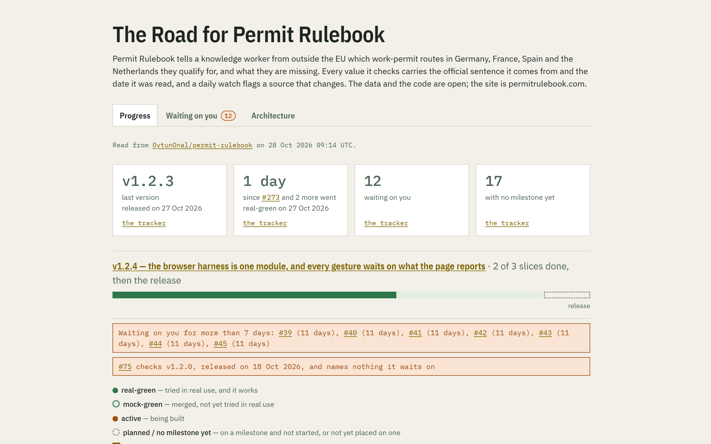
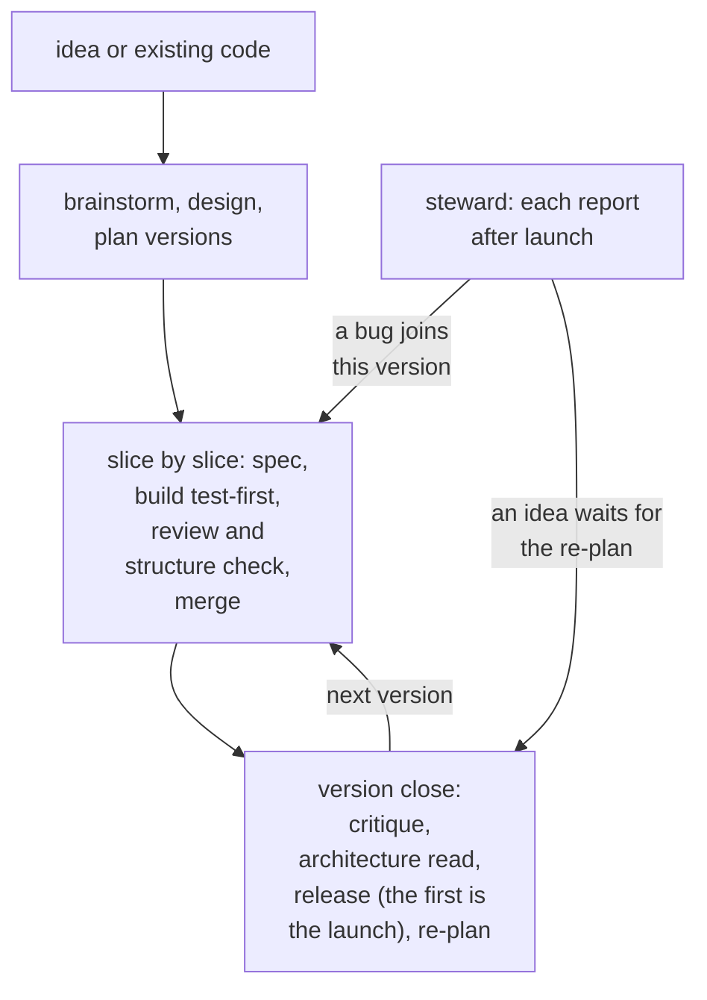

<div align="center">
  <picture>
    <source media="(prefers-color-scheme: dark)" srcset="assets/logo-dark.svg">
    
  </picture>
  <p>A Claude Code plugin that runs a project from an idea to a maintained product, on top of <a href="https://github.com/mattpocock/skills">Matt Pocock's skills</a>.</p>
  <p>
    
    <a href="https://github.com/OytunOnal/roadkeeper/releases"></a>
    <a href="LICENSE"></a>
  </p>
  <p>
    <a href="#try-it">Try it</a> ·
    <a href="#what-it-does-now">What it does</a> ·
    <a href="#what-you-can-rely-on">What you can rely on</a> ·
    <a href="https://github.com/OytunOnal/roadkeeper/releases">Releases</a>
  </p>
</div>

<p>
  <picture>
    <source media="(prefers-color-scheme: dark)" srcset="assets/the-road-dark.png">
    
  </picture>
</p>

You decide at every checkpoint; each slice is specced, built test-first and reviewed in a pull request; and the work lives on your issue tracker, drawn as one page, The Road.

It is for a developer who builds and maintains software in Claude Code and wants the project to stay decided, verified and legible across sessions.

<details>
<summary>Contents</summary>

- [What it does now](#what-it-does-now)
- [Try it](#try-it)
- [Words](#words)
- [What you can rely on](#what-you-can-rely-on)
- [What Roadkeeper is not](#what-roadkeeper-is-not)
- [Where it is going](#where-it-is-going)
- [Proven on](#proven-on)
- [Feedback](#feedback)
- [Licence](#licence)

</details>



## What it does now

- **From an idea:** `/roadkeeper:genesis` sizes the project with you in four questions, brainstorms it into a one-pager weighed against market research, has you pick a design from its mockups, and plans the versions on your GitHub tracker.
- **From existing code:** `/roadkeeper:adopt` takes stock of what the code already does, walks you through it for your corrections, then plans the same way.
- **Version by version:** the work is planned as small versions, each named by what the product can do; new ideas wait as candidates, and at each version's close everything open is re-planned with you, its critique's and architecture read's findings included. A version's number says what changed for you: the first number rises when you must act.
- **Slice by slice:** each slice is built test-first and reviewed in a pull request against your coding standards, its spec or issue, and security; one larger than a ticket, or with a new screen, is first questioned with you until every decision is made and written as a spec. Before it merges, you see what it changes that can be seen, served from its branch; once its checks pass, it merges on its own.
- **Tried for real:** a merged slice turns real-green only once it has been used for real and works.
- **A retro after each slice:** it reads the slice's sessions and proposes changes to your checks, rules and docs; it brings you those seen in two of the last three retros, or severe ones, and keeps the rest as notes.
- **At each version's close:** a critique walks the product as a first-time user, the architecture is read, and from v1 on a release says what the product can do now; before the first launch, the name, the licence and the launch checklist are settled too.
- **After launch:** `/roadkeeper:steward` takes each report: a bug is traced to the promise the product broke, with fixes offered for you to pick; an idea becomes a candidate.
- **The Road:** one page drawn from the tracker and the code's structure, showing progress by version, what waits on you, and the code's levels and modules.
- **Architecture:** the code follows clean architecture's dependency rule, the domain at the centre and every dependency pointing inward, and is grouped into deep modules: a folder behind one entry file, everything inside private, on one level or several, nested as it grows. The structure check holds both before every merge in JavaScript, TypeScript, Astro and Python code, The Road draws them, and each version's close reads the code against them, so what an agent writes stays legible as it grows. [The rules](skills/slice/references/structure.md).
- **While it works:** hooks run your linter on every file written and tell you at each session start what waits on you.

What changed in each version: the [releases](https://github.com/OytunOnal/roadkeeper/releases).

## Try it

A plugin runs code in your session. Roadkeeper's are the hooks under `scripts/` ([What you can rely on](#what-you-can-rely-on)), and each acts only in a project holding `docs/roadkeeper/`: in your other projects they do nothing. `nudge`, at each session start, reads the tracker through `gh` with your login and rewrites its snapshot, `docs/roadkeeper/issues.json`, which your `.gitignore` names once the tools' setup has run; on the default branch only, it also redraws The Road, `docs/roadkeeper/road.html`, for you to commit. `road-redraw`, after a command that writes to the tracker, reads it the same way and, on the default branch only, rewrites the snapshot and redraws The Road, for you to commit. `merge-guard` reads the pull request a `gh` merge names; nothing else leaves your machine. The check at write runs your project's linter, as your `docs/roadkeeper/commands.json` names it. Read them, and the scripts they run or import from `scripts/`, before you install it.

1. In a terminal, install the skills Roadkeeper calls. This installs all of Matt Pocock's skills, for every project on your machine (`-g`), without asking (`-y`):

   ```
   npx skills@latest add mattpocock/skills -g -a claude-code -s '*' -y
   ```

2. Open Claude Code in your project's folder, and type:

   ```
   /plugin marketplace add OytunOnal/roadkeeper
   /plugin install roadkeeper@roadkeeper
   ```

3. In that session, type:
   - `/setup-matt-pocock-skills`, one of Matt Pocock's skills installed in step 1: once per project, the tracker and its labels;
   - `/roadkeeper:genesis` to start from an idea, or `/roadkeeper:adopt` to start from existing code;
   - `/roadkeeper:steward` after launch, with a report or without.

It works when `docs/roadkeeper/road.html` opens with your project's name on it. Needs Claude Code with plugins, `gh` logged in, and Node 20 or newer; the structure command needs Node 22 or newer.

## Words

- **Slice**: an issue on a milestone, named by what becomes possible once it lands.
- **Milestone**: a version, named by what the product can do; closed with a release from v1 on.
- **mock-green / real-green**: merged, not yet tried in real use; tried in real use and working.
- **waiting-on-you**: an issue only you can act on.
- **Genesis**: the mode from idea to launch.
- **Steward**: the mode after launch.
- **The Road**: the page drawn from the tracker, in three tabs: progress (done, now, next, ahead), waiting on you, architecture.

## What you can rely on

A change to one of these that makes you act, a file to move or a command to type differently, comes only in a major version, and its release says what to do.

- **Skills**, each `/roadkeeper:<name>`: `adopt`, `brainstorm`, `design-critique`, `devils-advocate`, `genesis`, `idea`, `launch`, `market-research`, `product-critique`, `retro-spec`, `road`, `slice`, `steward`.
- **Commands**, `node <roadkeeper>/scripts/<name>.mjs` in your project's root, `<roadkeeper>` being the folder Claude Code installed the plugin into, each with its usage in its header: `copy-lint-rules`, `green`, `red-before`, `road`, `same-cases`, `structure`, `structure-check`, `structure-plan`, `structure-stamp`, `version-forecast`.
- **General rules**, `ROADKEEPER_STANDARDS.md` at Roadkeeper's root: the rules every project's review holds. A project changes one only by a departure, a line under `## Departures` in its `CODING_STANDARDS.md` naming the rule and why.
- **Hooks**, each acting only in a project holding `docs/roadkeeper/`:
  - `nudge`, at session start, counts what waits on you, rewriting `issues.json` and, on the default branch only, redrawing The Road;
  - `road-redraw`, after a command that writes to the tracker, rewrites `issues.json` and redraws The Road in the background, on the default branch only;
  - `git-alone`, before a shell command in one of the project's linked worktrees, refuses git chained to other commands;
  - `no-heredoc`, before a shell command, refuses an interpreter fed its program through a heredoc or here-string;
  - `merge-guard`, before a shell command, refuses `gh pr merge`, or a push to the default branch or a tag, until the tree that lands has run green;
  - `check-at-write`, after Write or Edit, refuses the written file's breaches of your project's linter;
  - `skills-pointer`, at every session start and after a compact or a clear, tells the session to work from Roadkeeper's skill files.
- **Files your project keeps**, under `docs/roadkeeper/`:
  - `structure.json`, the structure command's graph of your JavaScript, TypeScript, Astro and Python files (an Astro file's level tag opens its frontmatter; a Python file's is its first `#` comment, `# @level`), and `dependency-rules.md`, your levels and exceptions (`skills/slice/references/structure.md`);
  - `commands.json`, your project's own commands, which the green, red-before, same-cases and the hooks run (`skills/slice/references/project-tools.md`): its `js-ts` stack reads JUnit and ESLint's JSON, its `python` stack pytest's JUnit and the lint line `path:line:col: CODE message`; and `ceilings.json`, the files over 400 lines;
  - `one-pager.md`, `assumptions.md`, `ARCHITECTURE.md`, `threats.md`, `metrics.md`;
  - `design/`, `critiques/`, `research/`;
  - `issues.json`, the tracker's snapshot, and `road.html`, The Road, both written by the `road` command and by the `nudge` and `road-redraw` hooks.

## What Roadkeeper is not

- Not a code generator: the build is Pocock's `implement-spec` and `tdd`.
- Not autonomous: nothing merges before you have seen what can be seen and its checks pass, and it never publishes on its own.
- Not a hosted service: files in your repository, issues on your tracker.

## Where it is going

The next versions, by their titles:

- v3.0.1 — The Road says plainly what it shows
- v3.0.2 — The tools and the plugin's parts are deep modules
- v3.1.0 — Roadkeeper's own tools and rules cost a session less
- v3.1.1 — Roadkeeper's tools say what they did, and a slice runs without a hand
- v3.2.0 — The checks see more
- v3.3.0 — Every project's checks fit its code
- v3.3.1 — Roadkeeper's own checks are kept once and prove a change in one run

## Proven on

[permitrulebook.com](https://permitrulebook.com) and a private codebase run on Roadkeeper, and Roadkeeper is built with itself. Made by Oytun Önal.

## Feedback

Open an issue on [this repository](https://github.com/OytunOnal/roadkeeper/issues). Pull requests are not merged: each release replaces this repository's tree, so describe the change you want in an issue instead.

## Licence

[MIT](LICENSE). Skills copied from upstream keep their licence beside them: `brainstorm` and `launch` (Addy Osmani's agent-skills), `retro-spec` (Matt Pocock's skills), all MIT. Osmani's code-review lines sit in `ROADKEEPER_STANDARDS.md`, their licence in `skills/genesis/`.
